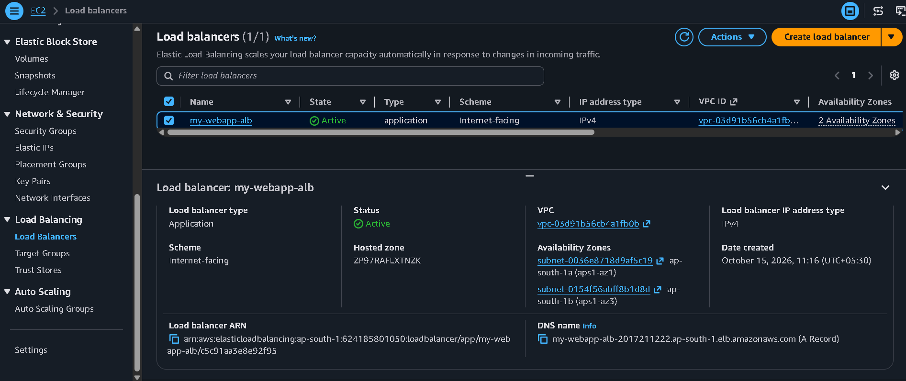
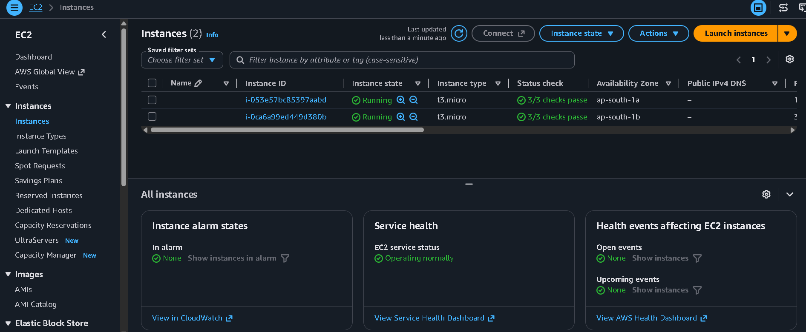
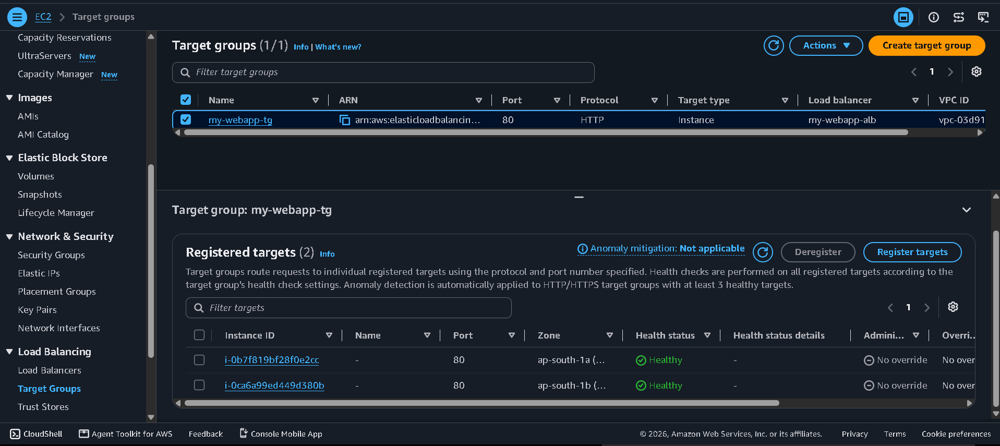
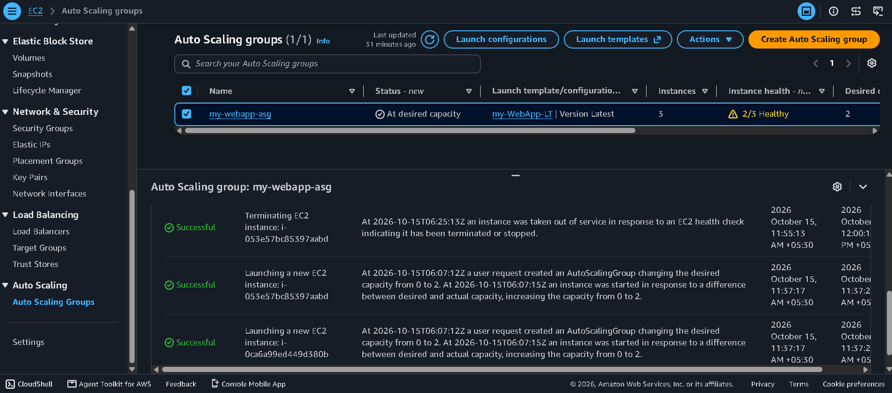
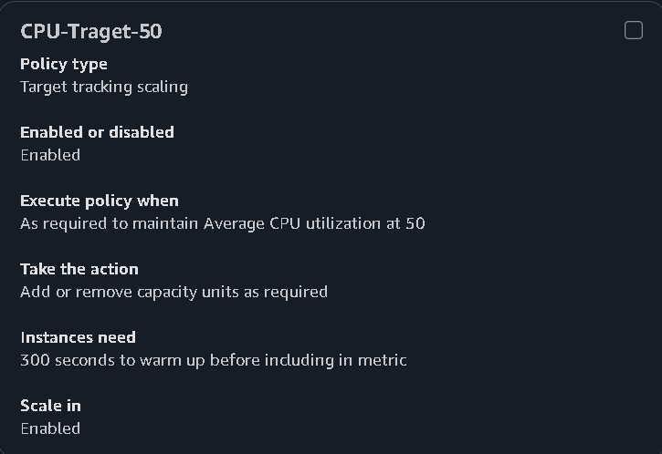
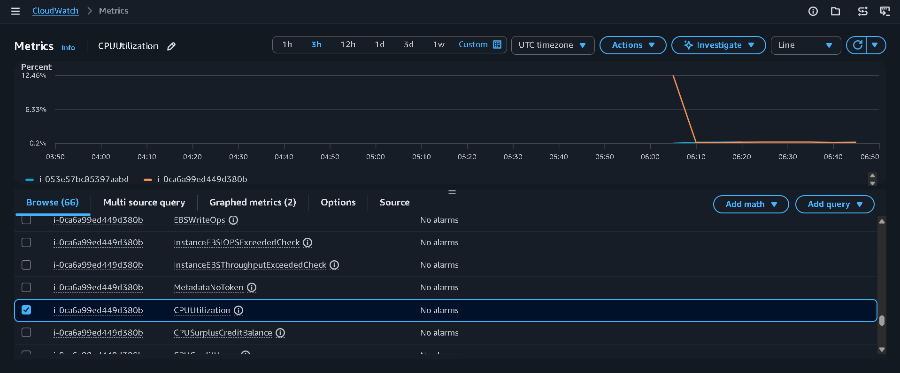
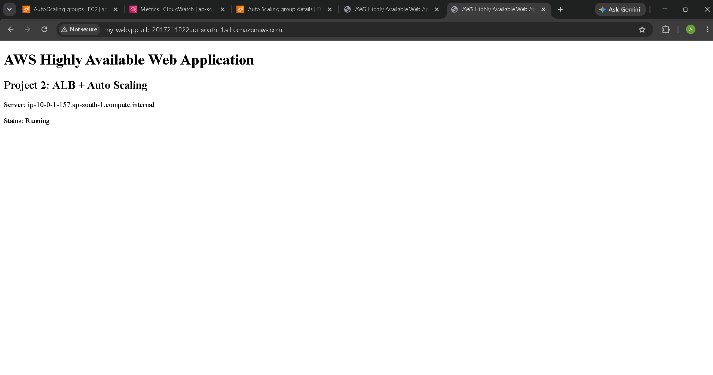

# 🚀 AWS Highly Available Web Application

## 📌 Project Overview

This project demonstrates how to deploy a highly available web application on Amazon Web Services (AWS) using an Application Load Balancer, Amazon EC2 Auto Scaling, and Amazon CloudWatch.

The application distributes incoming HTTP traffic across EC2 instances and automatically replaces terminated instances using an Auto Scaling Group.

## 🎯 Project Objectives

- 🌐 Deploy a web application on Amazon EC2.
- ⚖️ Distribute incoming traffic using an Application Load Balancer (ALB).
- 🔄 Configure EC2 Auto Scaling for instance replacement.
- 📊 Monitor CPU utilization using Amazon CloudWatch.
- 🛡️ Test application availability after terminating an EC2 instance.
- 🔐 Configure security groups to control HTTP traffic.

## 🏗️ AWS Services Used

| AWS Service | Purpose |
|---|---|
| Amazon EC2 | Hosts the web application |
| Application Load Balancer | Distributes incoming HTTP traffic |
| EC2 Auto Scaling | Maintains and replaces EC2 instances |
| Target Groups | Tracks the health of registered instances |
| Amazon CloudWatch | Monitors CPU utilization |
| Amazon VPC | Provides network isolation |
| Security Groups | Controls network traffic |

## ⚙️ Architecture

The application follows this traffic flow:

**👤 User → ⚖️ Application Load Balancer → 🎯 Target Group → 💻 EC2 Instances**

🔄 The Auto Scaling Group automatically replaces terminated EC2 instances, while 
📊 CloudWatch monitors CPU utilization.

## 🔐 Security Configuration

- ✅ Allowed HTTP traffic on port 80 through the ALB security group.
- ✅ Configured the web server security group to accept HTTP traffic from the ALB security group.
- ✅ Avoided exposing web servers directly to public HTTP traffic.
- 🔒 No AWS credentials or secret keys should be committed to the repository.

## 🧪 Testing and Validation

The following tests were performed during the project:

1. ✅ Verified that the Application Load Balancer became active.
2. ✅ Confirmed that the target group reported two healthy targets.
3. 🔄 Terminated one Auto Scaling-managed EC2 instance.
4. ✅ Verified that the Auto Scaling Group launched a replacement instance.
5. 🌐 Confirmed that the application remained accessible through the load balancer during the test.
6. 📊 Reviewed CPU utilization graphs in Amazon CloudWatch.
7. ⚙️ Configured target tracking with a 50% average CPU utilization target.

## 📸 Project Screenshots

### 1. Application Load Balancer

### 2. EC2 Instances

### 3. Healthy Target Group

### 4. Auto Scaling Activity

### 5. Auto Scaling Policy

### 6. CloudWatch CPU Monitoring

### 7. Working Web Application

## 💰 Resource Cleanup

After completing the tests and capturing screenshots, the AWS resources were deleted to help prevent ongoing charges.

Always verify that no unused EC2 instances, EBS volumes, Elastic IPs, NAT Gateways, load balancers, or other billable resources remain.

Previously accrued charges may still appear in AWS Billing.

## 📚 Key Learnings

- ☁️ Understanding high availability and load balancing.
- 🔄 Configuring EC2 Auto Scaling and target tracking policies.
- 📈 Monitoring infrastructure using CloudWatch.
- 🔐 Configuring security groups and VPC networking.
- 🧪 Testing instance replacement and application availability.
- 🧹 Cleaning up AWS resources after completing a project.

## 👨‍💻 Author

**Rudrani025**

GitHub: https://github.com/Rudrani025

---

⭐ **Built to demonstrate AWS cloud architecture, high availability, load balancing, and automated scaling using real-world hands-on implementation.**

